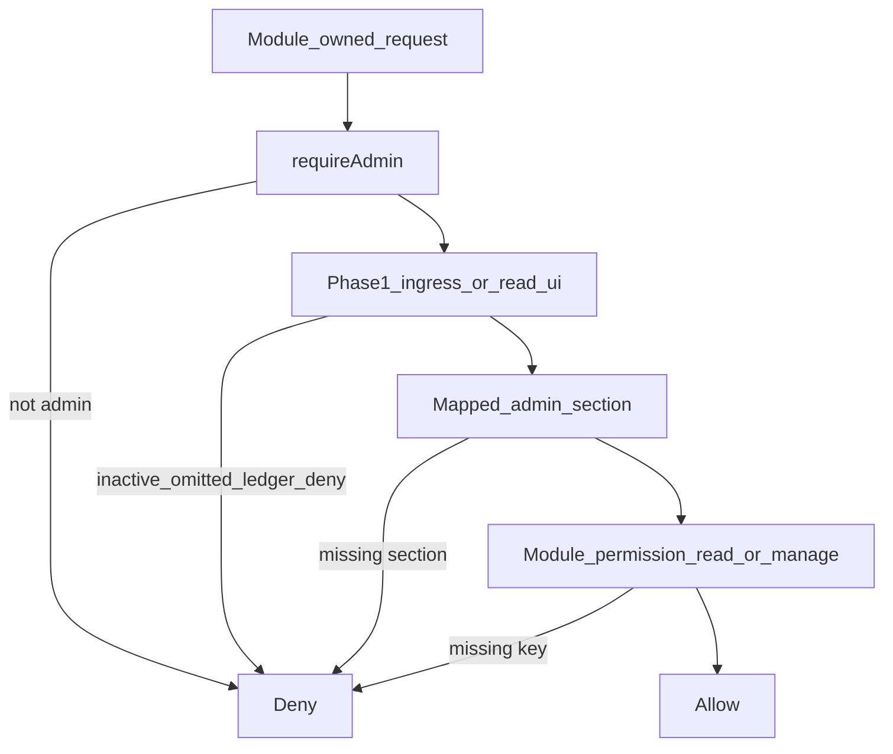

# Phase 3 — Application settings and permission contracts

**Status:** Complete (implementation + contract evidence)  
**Parent:** [executive-application-platform-implementation-plan.md](./executive-application-platform-implementation-plan.md) Phase 3  
**Locks:** [phase-0-decisions-freeze.md](./phase-0-decisions-freeze.md)  
**Prior exit:** [phase-2-state-transitions.md](./phase-2-state-transitions.md) · [phase-1-runtime-ingress-matrix.md](./phase-1-runtime-ingress-matrix.md)

## Objective

Give Modules a consistent, enforceable way to manage settings and user access — Core-owned, server-side, without Option B ZIP ACL/settings executors.

## Vocabulary

| Term | Meaning |
|------|---------|
| Admin section grant | Coarse dashboard shell ACL (`User.adminSectionGrants`) |
| Module permission key | `{packageId}.read` or `{packageId}.manage` (manage ⇒ read) |
| Module permission grants | `User.modulePermissionGrants` — `null` = inherit from section map; `[]` = none; non-empty = allowlist |
| Settings registry | Core Zod schemas + `ModuleSetting` rows keyed by `(packageId, key)` |
| Secret key | Registry-marked setting key; never returned raw on export |

## Permission flow

Order for mutations: **availability/ingress first**, then Module permission. Never rely on hidden nav or client checks as authorization.

### Section → Module map

| Module id | Admin section | Registered keys |
|-----------|---------------|-----------------|
| `documentation` | `modules` | `documentation.read`, `documentation.manage` |
| `status-page` | `modules` | `status-page.read`, `status-page.manage` |
| `marketing` | `marketing` | `marketing.read`, `marketing.manage` |
| `advanced-seo` | `seo` | `advanced-seo.read`, `advanced-seo.manage` |

### Null grant semantics

| `modulePermissionGrants` | Effect |
|--------------------------|--------|
| `null` | For each registered Module whose mapped section the admin holds, both `.read` and `.manage` are implied |
| `[]` | No Module permissions (even if section held) |
| explicit array | Only listed keys; `.manage` implies `.read` for the same package id |

`SUPER_ADMIN` always passes. Capabilities remain profile/display-only — **not** ACL.

## Ingress × permission (extends Phase 1)

Permission column is the **additional** check after Phase 1 availability. Public soft reads stay unauthenticated and do not require Module ACL.

### documentation

| Surface | Class | Permission |
|---------|-------|------------|
| Admin layout / pages | read_ui | `documentation.read` (section `modules`) |
| Mutations (`actions.ts`) | mutation | `documentation.manage` |
| Service / builder public reads | public_read | none (availability soft) |

### status-page

| Surface | Class | Permission |
|---------|-------|------------|
| Admin layout / pages | read_ui | `status-page.read` |
| Mutations | mutation | `status-page.manage` |
| Public API / builder | public_read | none |

### marketing

| Surface | Class | Permission |
|---------|-------|------------|
| Admin layout / panels | read_ui | `marketing.read` |
| Admin actions / settings writes | mutation | `marketing.manage` |
| Privileged API / jobs / OAuth callbacks that already require admin | privileged_callback / job | `marketing.manage` |
| Public soft ingest / short-link after route allow | public_read / callback | none beyond Phase 1 ingress |

### advanced-seo

| Surface | Class | Permission |
|---------|-------|------------|
| Advanced admin pages | read_ui | `advanced-seo.read` |
| Guarded Advanced mutations / APIs / queue admin | mutation / job / privileged_callback | `advanced-seo.manage` |
| Basic SEO (non-Advanced) | — | unchanged (not Module ACL) |

Modules Manager ZIP / update / uninstall / remove stay on `system` section (`requireAdminSection("system")`) — not Module configure ACL.

## Settings registry contract

| Concern | Rule |
|---------|------|
| Ownership | Core registry + Prisma `ModuleSetting`; schemas in `src/modules/<id>/settings.ts` |
| Identity | `(packageId, key)` unique; `schemaVersion` on row |
| Defaults | Missing keys filled from registered defaults on read |
| Secrets | `secretKeys` in registry; export redacts; audit never stores secret payloads |
| Reset | Restores defaults; clears secret values |
| Import | Refuses to wipe secrets unless explicit replace flag |
| Deactivate | **Retains** settings rows (≠ reset ≠ purge) |
| ZIP | Cannot register settings schemas or executors |
| Marketing | Dual-store adapter for one secret-bearing path; no big-bang table rewrite |

## Explicit non-goals

- ZIP-granted ACL or settings executors (Option B)
- Capability-as-ACL / Modules Manager capability toggles
- SiteFeature-as-settings
- Full Marketing settings migration
- Phase 5 Modules Manager redesign (only light settings deep-link)
- CMS `SiteSettings` takeover
- Purge / content wipe product

## Implementation status

| Slice | Topic | Status | Evidence |
|-------|-------|--------|----------|
| P3.1 | This spec | **Done** | This file + `10` / `02` pointers |
| P3.2 | Permission registry + grants | **Done** | `module-permissions.ts`, `User.modulePermissionGrants`, `requireModulePermission`, `module-permissions.test.ts` |
| P3.3 | Module guard migration | **Done** | Docs/Status/Marketing/Advanced SEO asserts + layouts + marketing admin APIs |
| P3.4 | Settings registry + persistence | **Done** | `module-settings.ts`, `ModuleSetting` model + migration |
| P3.5 | Documentation + Marketing pilots | **Done** | `documentation/settings.ts`, `marketing/settings.ts` (+ status-page), save/export actions |
| P3.6 | Secrets / export / reset / audit | **Done** | Redaction, `replaceSecrets`, security-audit actions, `09`/`10` docs |
| P3.7 | Assignment UI + settings link | **Done** | `user-permissions-form.tsx`, Modules Manager `settingsHref` |
| P3.8 | Exit artifact | **Done** | This file + README / executive pointers |

**Exit gate:** One permission flow documented and enforced server-side; representative read/manage tested at Module ingress types; settings read/update/migrate/reset without exposing secrets; contract tests green.
